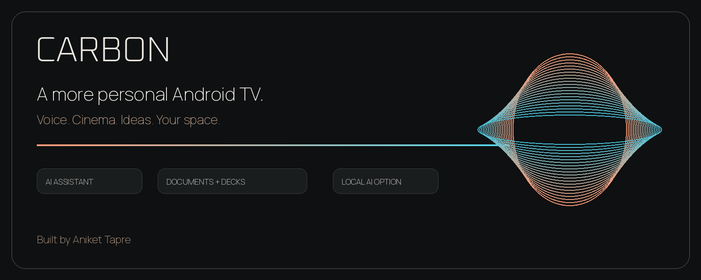
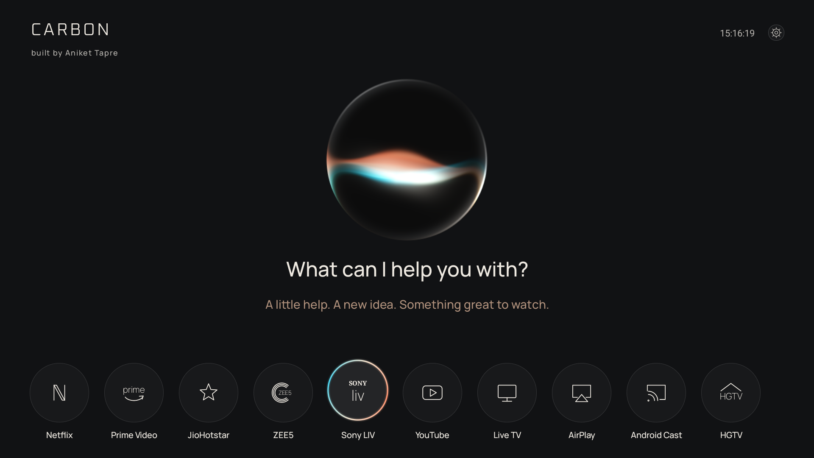
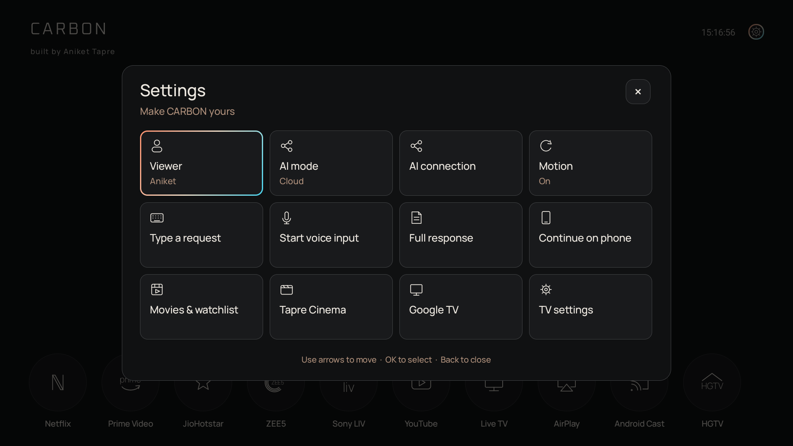
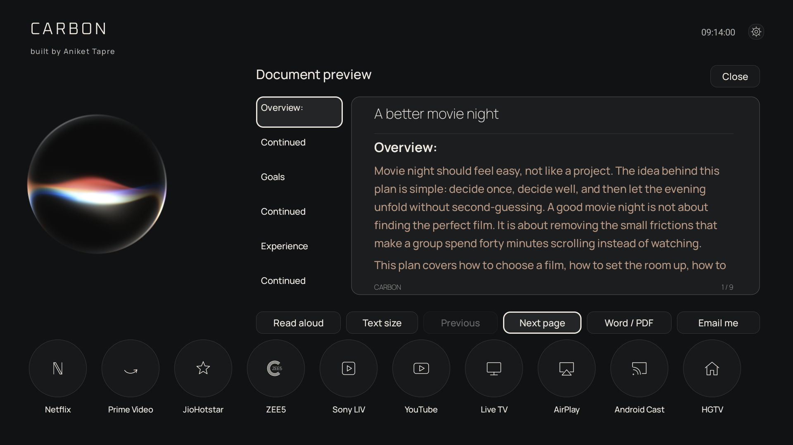
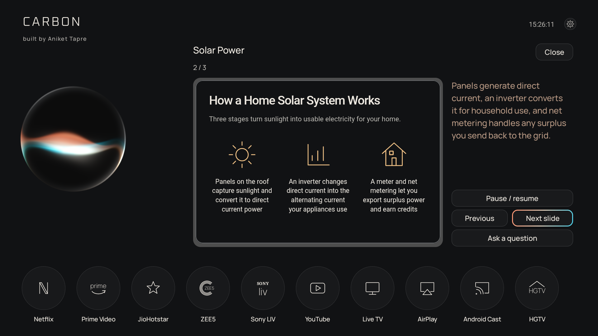
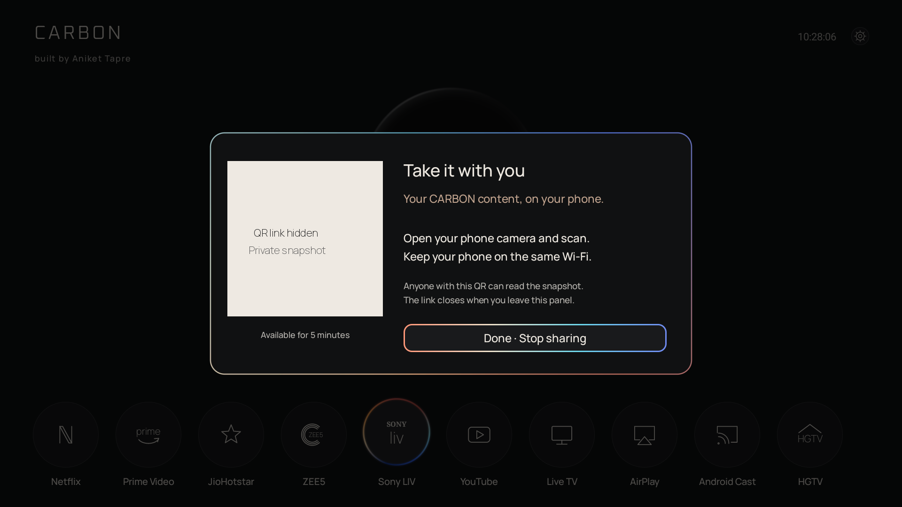

<p align="center"></p>

<p align="center">
  <a href="#experience">Experience</a> ·
  <a href="#getting-started">Getting started</a> ·
  <a href="docs/SETUP.md">Setup guide</a> ·
  <a href="docs/PRIVACY.md">Privacy</a> ·
  <a href="#contributing">Contribute</a>
</p>

# Your TV. A little more capable.

CARBON brings a conversational assistant, your streaming-app shortcuts, documents and presentations into a calm Android TV interface. Built by **Aniket Tapre**, starting with a real living-room TV.

**Early developer release.** CARBON is a launcher and assistant application, not replacement Android firmware. Root access is not required. Compatibility varies across TV manufacturers, remotes and streaming apps.

## Experience



<table>
<tr><td width="50%"><b>A home that feels considered</b><br>Matte surfaces, rounded controls and clear remote focus.</td><td width="50%"><b>Ideas beyond the search box</b><br>Readable documents with Word and PDF export.</td></tr>
<tr><td><b>Present on the big screen</b><br>Review a generated deck, step through slides and ask follow-up questions.</td><td><b>Take something with you</b><br>A temporary, read-only phone snapshot over your local network.</td></tr>
</table>

Screenshots show the installed personal build. Private addresses and QR links are masked. This public source replaces the original restricted-license shader with an original Canvas orb, so its visual appearance differs. Screenshots are product illustrations, not evidence that every third-party service works on every TV.

## What is included

| Area | Capabilities |
| --- | --- |
| Home | Animated orb, circular app dock, clock, settings grid and remote navigation |
| AI | Fireworks integration, tool-supported content creation, typed requests and conversation context |
| Voice | Android remote dictation, Sarvam Aparna replies and streamed captions |
| Creation | Document reading, DOCX/PDF export, presentation review and slide navigation |
| Email | Optional AgentMail delivery after an explicit user action |
| Cinema | Native app search where available, watchlists, language and spoiler preferences |
| Live TV | Player for streams you configure and are entitled to use |
| Casting | Handoff to compatible TV AirPlay and Google Cast receivers |
| Profiles | Separate watchlists and preferences for household viewers |
| Local AI | Ollama local-only or local-first routing with explicit cloud fallback choice |
| Phone | Expiring read-only snapshot link, with stop-sharing controls |

## What to expect today

- **Remote-button voice works as the primary interaction.** Continuous listening and interruption require usable microphone hardware and are not validated on the tested TCL remote. No always-listening wake word is promised.
- **Movie search is native-app dependent.** Applications may expose no searchable catalogue. CARBON does not guarantee a complete subscription catalogue, latest releases, posters or universal autoplay.
- **Bring your own services.** No API keys, accounts, email inboxes, stream subscriptions or casting licences are included. Third-party services may charge fees.
- **Local AI is not a network firewall.** Streaming apps can still access the internet. Cloud speech is controlled separately.
- **Profiles are convenience separation.** They are not authentication or parental locks.
- **Home behavior varies.** Use your TV's supported default-launcher settings. This repository does not root a TV or disable its recovery launcher automatically.

## Getting started

Requirements: **JDK 17**, **Android SDK 35**, Python 3 for setup tools, and an Android TV device running Android 8.0 or later. The source targets an Android TV development workflow; other devices are not certified.

```sh
git clone https://github.com/atapre-collab/carbon-tv.git
cd carbon-tv
./gradlew :app:assembleDebug
adb install app/build/outputs/apk/debug/app-debug.apk
```

Launch CARBON once on the TV. Then configure only the providers you intend to use:

```sh
python3 tools/setup.py --device YOUR_ADB_SERIAL --provider fireworks
python3 tools/setup.py --device YOUR_ADB_SERIAL --provider sarvam
```

The tool prompts privately for keys. Do not place keys in source files or GitHub issues. See the [setup guide](docs/SETUP.md) for local AI, email, stream configuration, and recovery notes.

The package ID matches the personal prototype. Installing this build over an existing CARBON installation may fail if signing keys differ. Back up your own settings before replacing an installation. The repository does not include the author's signing key.

## Development

```sh
python3 tools/test.py
python3 -m unittest discover -s backend -p 'test_*.py'
./gradlew :app:assembleDebug
```

The Android implementation is in `app/src/main`. The legacy experimental text-only relay is in `backend`; it is not the current full AI/tool pipeline; device setup helpers are in `tools`. Tests cover selected command, voice-draft, configuration and activation behavior. Passing tests does not establish universal TV compatibility.

## Privacy and security

Provider keys are supplied by each user. The release excludes personal credentials, device keys, build outputs and deployment history. Review [privacy](docs/PRIVACY.md) and [security reporting](SECURITY.md) before deploying beyond a trusted household network.

## Contributing

Small, focused contributions are welcome. Useful areas include device compatibility, reliable native search adapters, accessibility, performance measurements and UI testing. Start with [CONTRIBUTING.md](CONTRIBUTING.md).

The conversational phone companion, broader verified movie availability, and richer device integrations remain future work. Please do not present those as completed features.

## License and acknowledgements

Original CARBON source is provided under the [MIT License](LICENSE). Third-party dependencies, fonts and marks retain their own terms; see the bundled notices. Streaming-service names and logos identify integrations and do not imply endorsement. The private prototype's restricted shader, service credentials, signing keys, unverified TV feeds and screensaver video are not included in this source release.

<p align="center">Built by Aniket Tapre · Designed for the living room.</p>
